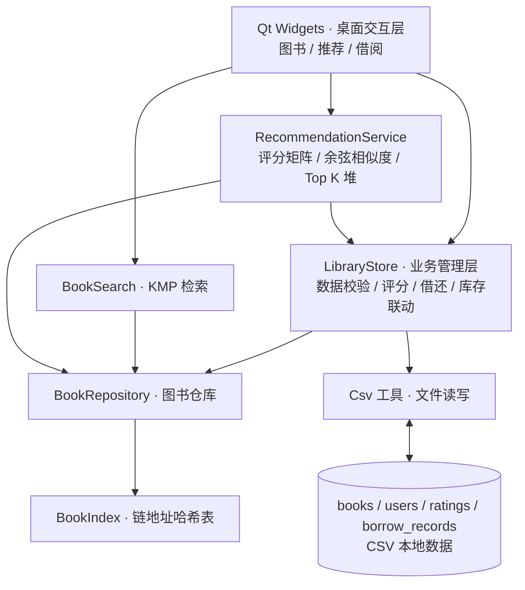

<div align="center">


# 📚 Book Recommendation System

### 基于哈希索引与用户协同过滤的图书检索及个性化推荐系统

**Fast Search · Personalized Discovery · Local-First Experience**

<p>
  
  
  
  
</p>


一套将**数据结构、检索算法、个性化推荐**与 **Qt 桌面交互**相结合的本地图书应用。

[项目概览](#-项目概览) · [核心功能](#-核心功能) · [系统架构](#-系统架构) · [算法设计](#-核心算法) · [快速开始](#-快速开始) · [测试验证](#-测试验证)

</div>

---

## ✨ 项目概览

**Book Recommendation System** 是使用 **C++17、Qt 6 Widgets 与 CMake** 构建的图书检索及个性化推荐桌面程序。

系统以图书信息为中心，将**编号索引、关键字匹配、用户评分、协同过滤、借阅管理、库存维护和 CSV 持久化**整合为完整的本地交互流程：既可以快速定位和管理图书，也可以利用用户评分发现可能感兴趣的读物。

| 🔍 高效检索                    | 🧠 智能推荐                | 📖 借阅管理         | 💾 本地优先          |
| :---------------------------- | :------------------------ | :----------------- | :------------------ |
| 哈希编号索引 + KMP 关键字匹配 | 用户协同过滤 + Top K 排序 | 借还记录与库存联动 | UTF-8 CSV，离线运行 |

项目采用清晰的**界面层—业务层—算法/数据层—持久化层**分工，便于理解、测试和扩展。

## 🚀 核心功能

| 模块           | 功能说明                                                     |
| :------------- | :----------------------------------------------------------- |
| **图书管理**   | 展示图书目录，新增、编辑、删除图书，并校验编号、书名、作者、分类和库存 |
| **快速检索**   | 通过图书编号精确定位；对书名、作者进行关键字匹配             |
| **用户评分**   | 对指定图书进行 **1–5 分**评价，同一用户对同一本书再次评分时更新原记录 |
| **个性化推荐** | 基于共同评分计算用户相似度，对目标用户未评分的图书生成推荐结果 |
| **Top K 排名** | 使用数组实现的小顶堆筛选推荐候选，并展示预测分数及推荐来源   |
| **热门回退**   | 缺少可用相似用户时，以评分人数和平均分作为热门推荐依据       |
| **借阅归还**   | 创建借阅记录、办理归还、同步调整库存，并防止零库存借出与重复在借 |
| **数据持久化** | 读写四类 CSV 文件；对异常数据、无效引用和文件读写错误提供校验与提示 |

评分保存后可以重新计算推荐；借阅归还操作也会同步更新图书列表与推荐候选。推荐时仅考虑**当前有库存且目标用户尚未评分**的图书。

## 🏗️ 系统架构



**架构说明**

- **交互层**：`mainwindow_ui.cpp` 创建业务页面、连接界面事件，`mainwindow.cpp` 处理用户操作与结果刷新。
- **业务层**：`LibraryStore` 统一管理图书、用户、评分和借阅记录，执行数据校验和保存。
- **数据与算法层**：`BookRepository` 维护图书实体，`BookIndex` 与 `BookSearch` 负责检索，`RecommendationService` 负责推荐计算。
- **持久化层**：通过 `Csv` 工具处理文件读写；程序启动时可从内置资源初始化样例数据。

## 🧠 核心算法

### 01 / 链地址哈希索引

采用**桶数组 + 单链表**处理编号哈希冲突，索引保存“图书编号 → 图书数组下标”的映射，完整实体保存在 `BookRepository` 中。加载或删除图书后同步维护索引一致性。

- 平均查找复杂度：**O(1)**（负载因子受控时）
- 最坏查找复杂度：**O(n)**

### 02 / KMP 关键字匹配

基于 KMP 字符串匹配实现对**书名与作者**的关键词检索，返回符合条件的图书记录。

- 单次文本匹配复杂度：**O(n + m)**（`n` 为文本长度，`m` 为模式长度）

### 03 / User-Based Collaborative Filtering

使用**用户—图书评分矩阵**组织评分数据，并依据两名用户的**共同评分图书**计算余弦相似度：

$$
\mathrm{sim}(u,v)=
\frac{\sum_{i\in I_{uv}}r_{u,i}r_{v,i}}
{\sqrt{\sum_{i\in I_{uv}}r_{u,i}^{2}}\sqrt{\sum_{i\in I_{uv}}r_{v,i}^{2}}}
$$

其中，$I_{uv}$ 为两名用户共同评分过的图书集合。对目标用户尚未评分的图书，根据相似用户的评分执行加权预测：

$$
\hat r_{u,i}=\frac{\sum_{v\ne u}\mathrm{sim}(u,v)\,r_{v,i}}
{\sum_{v\ne u}\mathrm{sim}(u,v)}
$$

计算时仅纳入对候选图书有评分、且与目标用户具有**正相似度**的其他用户。当没有共同评分或权重之和为零时，使用热门推荐逻辑回退，避免无效计算。

### 04 / Top K 小顶堆

针对每本候选图书构建推荐结果，并使用**容量为 K 的小顶堆**在线维护优先级最高的 K 项：

- 堆未满时插入新候选；堆满时仅使用更优的候选替换堆顶。
- 堆操作复杂度：**O(log K)**；扫描 `M` 个候选约为 **O(M log K)**。
- 最终结果按规则排序；协同过滤项优先于热门回退项，热门项优先考虑评分人数。

## 🛠️ 技术栈

| 领域         | 技术                                        |
| :----------- | :------------------------------------------ |
| 语言标准     | C++17                                       |
| 桌面 UI      | Qt 6.5+ / Qt Widgets                        |
| 构建系统     | CMake 3.19+                                 |
| 开发环境     | Qt Creator，配套桌面 Kit（MinGW / MSVC 等） |
| 核心数据结构 | 动态数组、链地址哈希表、评分矩阵、二叉堆    |
| 本地存储     | UTF-8 CSV 文件                              |
| 资源与国际化 | Qt Resource System、Qt Linguist             |
| 测试         | CTest、Smoke Test、检索基准程序             |

## ⚡ 快速开始

### 环境要求

安装 **Qt Creator**、**Qt 6.5 或更高版本**、**CMake 3.19 或更高版本**，以及与所选 Qt 版本匹配的 C++ 编译器。项目依赖 Qt **Core、Widgets 和 LinguistTools** 组件。

### 获取项目

```bash
git clone https://github.com/ZhangJian-CN/book-recommendation-system.git
cd book-recommendation-system
```

### 方式一：Qt Creator（推荐）

1. 使用 Qt Creator 打开项目根目录的 `CMakeLists.txt`。
2. 选择已配置好的 **Qt 6 Desktop Kit**。
3. 等待 CMake 配置完成，执行 **构建 → 运行**。

### 方式二：CMake 命令行

确保 Qt 6 开发环境可被 CMake 找到后执行：

```bash
cmake -S . -B build
cmake --build build --config Debug
```

如果提示找不到 Qt，请在 Qt Creator 中选择正确的 Kit，或通过 `CMAKE_PREFIX_PATH` 指定 Qt 安装目录。

### 自定义数据目录

程序支持 `--data-dir` 参数。请将下面的可执行文件名称替换为实际构建后的路径：

```bash
BookRecommendation --data-dir "/path/to/data"
```

- 不指定时，默认使用**可执行文件所在目录**下的 `data/`。
- 当数据目录不存在或为空时，程序会将四份内置样例 CSV 初始化到该目录。
- 后续启动沿用该目录中的数据，适合检查关闭程序后修改是否仍然保留。

> **提示**：运行时编辑的是选定数据目录中的 CSV，不一定是仓库源码目录下的 `data/`。重要演示数据建议提前备份。

## 🗂️ 项目结构

```text
book-recommendation-system/
├── CMakeLists.txt                # 构建、测试与部署配置
├── main.cpp                      # 程序启动、数据目录及初始化
├── mainwindow.h/.cpp             # 主窗口业务响应
├── mainwindow_ui.cpp             # 界面布局与交互连接
├── mainwindow.ui                 # Qt Designer 窗口文件
├── bookrepository.h/.cpp         # 图书实体、操作与校验
├── bookindex.h/.cpp              # 链地址哈希索引
├── booksearch.h/.cpp             # KMP 关键词检索
├── librarystore.h/.cpp           # 用户、评分、借阅及持久化协调
├── recommendation.h/.cpp         # 协同过滤与 Top K 推荐
├── csvutil.h/.cpp                # CSV 读写工具
├── mainwindow_smoke.cpp          # 界面基础测试
├── bookrepository_smoke.cpp      # 图书仓库测试
├── hash_smoke.cpp                # 哈希相关测试
├── core_smoke.cpp                # 业务与推荐测试
├── borrow_smoke.cpp              # 借阅相关测试
├── large_demo_smoke.cpp          # 较大数据集验证
├── ui_polish_smoke.cpp           # 界面呈现测试
├── search_benchmark.cpp          # 检索性能基准程序
├── BookRecommendation_zh_CN.ts   # 中文翻译资源
├── seed.qrc                      # 初始数据资源
├── ui.qrc                        # 界面资源
├── data/                         # 基础 CSV 样例
├── demo_data/                    # 演示与测试数据
├── docs/                         # 项目文档
├── styles/                       # 界面样式资源
├── tools/                        # 辅助工具
└── README.md
```

> 上面列出的是项目的主要文件与目录，不包含所有测试辅助文件。

## 🗄️ 数据组织

项目用四份 CSV 维护数据，不需要额外安装数据库。

| 文件                 | 表头                                                       | 作用                     |
| :------------------- | :--------------------------------------------------------- | :----------------------- |
| `books.csv`          | `book_id,title,author,category,stock`                      | 图书基本信息和库存       |
| `users.csv`          | `user_id,name`                                             | 用户编号与姓名           |
| `ratings.csv`        | `user_id,book_id,score`                                    | 用户对图书的 1–5 分评分  |
| `borrow_records.csv` | `record_id,user_id,book_id,borrow_date,return_date,status` | 借阅日期、归还日期与状态 |

系统会对用户与图书引用、重复编号、评分范围、借还日期和借阅状态等进行校验。借还流程同时涉及 `books.csv` 与 `borrow_records.csv`，代码中包含事务标记、备份与恢复处理，以减少文件写入中断造成的不一致。

## ✅ 测试验证

仓库在 CMake 中配置了图书数据、哈希索引、业务核心、借阅逻辑、界面交互和演示数据等测试目标。

```bash
# 先完成构建
cmake -S . -B build
cmake --build build --config Debug

# 执行已注册的 CTest 测试
ctest --test-dir build -C Debug --output-on-failure
```

另外提供独立的 `search_benchmark` 构建目标，用于检索性能测试。请以本地实际运行结果作为性能结论；README 不预设未经验证的加速倍数或通过率。

---

<div align="center">


### Book Recommendation System

*From Data Structures to Personalized Book Discovery.*

<sub>Built with C++17 · Qt Widgets · CMake</sub>

</div>
