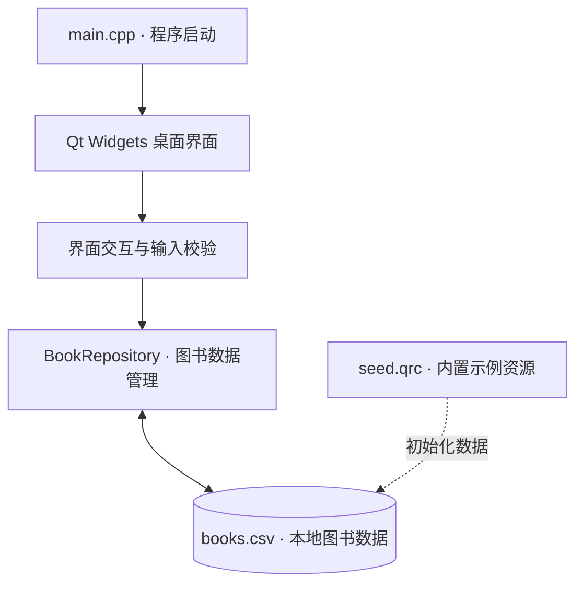

<div align="center">


# 📚 Book Recommendation System

### 基于哈希索引与用户协同过滤的图书检索及个性化推荐系统

**让图书检索更高效，让阅读发现更精准。**

<p>
  
  
  
  
  
</p>


以经典数据结构为基础，将桌面交互、图书数据管理与个性化推荐算法设计融入同一课程设计项目。

[项目介绍](#项目介绍) · [系统架构](#系统架构) · [核心技术](#核心技术) · [快速开始](#快速开始) · [数据组织](#数据组织) · [测试验证](#测试验证)

</div>

---

## 项目介绍

**Book Recommendation System** 是一个基于 **C++17 + Qt Widgets** 的本地图书信息管理与个性化推荐课程设计项目。

项目以校园图书应用场景为背景，围绕图书检索、数据维护、用户评分及推荐计算等问题，探索经典数据结构与推荐算法在实际桌面软件中的组织方式。系统采用 Qt 构建可视化界面，使用 CSV 维护本地数据，无需数据库服务器或在线服务即可运行基础图书管理功能。

设计重点包括：

- **高效数据访问**：研究基于哈希索引的精确查找与字符串匹配检索。
- **个性化信息发现**：以用户评分为依据，研究相似度计算与协同过滤推荐。
- **清晰的模块边界**：分离交互界面、数据操作、校验逻辑与文件持久化。
- **轻量化桌面体验**：原生 Qt Widgets 界面、本地数据存储、CMake 构建与自动化测试。

> **版本说明**：仓库当前可直接使用的部分以图书列表、编号查询、信息编辑、CSV 持久化和基础测试为主。推荐相关内容在本文的「核心技术」中作为课题算法设计进行介绍，不代表全部算法功能均已集成到当前界面。

## 产品能力

| 能力             | 说明                                             |
| :--------------- | :----------------------------------------------- |
| 📖 图书信息展示   | 在桌面界面中查看图书编号、书名、作者、分类与库存 |
| 🔎 编号快速定位   | 通过图书编号查询并选择对应记录                   |
| ✏️ 图书信息维护   | 编辑书名、作者、分类及库存信息                   |
| 💾 数据本地持久化 | 从 UTF-8 CSV 加载数据，并将修改写回文件          |
| 🛡️ 数据有效性校验 | 检查编号冲突、缺失字段、非法库存及异常 CSV 内容  |
| 🧪 基础质量验证   | 通过数据层与窗口交互的 Smoke Test 验证关键流程   |

## 系统架构

项目采用轻量化桌面应用架构，以 **Qt Widgets** 承载人机交互，以数据管理模块承载读写和校验逻辑，以 **CSV** 实现文件持久化。



**架构特点**

- **界面与数据逻辑分离**：降低 UI 交互与数据读写之间的耦合。
- **本地优先**：不依赖网络连接或远程数据服务。
- **数据可迁移**：CSV 格式易于查看、备份与交换。
- **易于调试**：CMake 管理构建，CTest 支持基础回归验证。

## 核心技术

本课题的算法设计以 **“检索效率 + 个性化推荐”** 为主线，将经典数据结构与实际业务问题对应起来。

| 技术方向   | 数据结构 / 算法                    | 设计思路                                         |
| :--------- | :--------------------------------- | :----------------------------------------------- |
| 精确检索   | 链地址哈希表                       | 对图书编号建立索引，使用桶数组与链表处理哈希冲突 |
| 关键字检索 | KMP 字符串匹配                     | 针对书名与作者文本进行模式匹配                   |
| 用户相似度 | 余弦相似度                         | 从共同评分记录中度量用户兴趣的相近程度           |
| 个性化推荐 | User-Based Collaborative Filtering | 根据相似用户的评分信息形成候选图书预测分数       |
| 排名筛选   | Top K 小顶堆                       | 使用有限容量的堆保留评分较高的候选结果           |
| 冷启动处理 | 热门度排序                         | 在用户评分较少时提供基于整体热度的推荐思路       |

**协同过滤的核心思想**：兴趣相近的用户可能偏好相似的图书。对用户间的共同评分进行比较后，可通过邻近用户的反馈估计目标用户对未评分图书的兴趣。

算法框架与数据结构选型服务于课程设计分析；具体运行能力请以仓库代码和测试结果为准。

## 技术栈

| 类别       | 技术选型                         |
| :--------- | :------------------------------- |
| 开发语言   | C++17                            |
| GUI 框架   | Qt 6.5+ / Qt Widgets             |
| 项目构建   | CMake 3.19+                      |
| IDE        | Qt Creator                       |
| 编译器     | 与 Qt Kit 匹配的 MinGW / MSVC 等 |
| 数据持久化 | UTF-8 CSV                        |
| 资源管理   | Qt Resource System（`.qrc`）     |
| 自动化测试 | CTest + Smoke Test               |

## 快速开始

### 环境要求

建议安装 **Qt Creator**、**Qt 6.5 或更高版本**、**CMake 3.19 或更高版本**及对应的桌面编译器。Windows 环境下可使用配套的 MinGW 64-bit Kit。

### 获取源码

```bash
git clone https://github.com/ZhangJian-CN/book-recommendation-system.git
cd book-recommendation-system
```

### 使用 Qt Creator（推荐）

1. 在 Qt Creator 中选择 **文件 → 打开文件或项目**。
2. 打开仓库根目录下的 `CMakeLists.txt`。
3. 选择已安装的 **Qt 6 Desktop Kit**。
4. 完成配置后点击 **构建**，再点击 **运行**。

### 使用 CMake 命令行

确保 CMake 能找到对应版本的 Qt：

```bash
cmake -S . -B build
cmake --build build --config Debug
```

可执行文件的具体位置取决于编译器与构建配置。Qt 未被自动识别时，可通过 Qt Creator 选择 Kit，或配置 `CMAKE_PREFIX_PATH`。

### 指定数据目录

程序支持通过启动参数指定 CSV 所在目录：

```bash
BookRecommendation --data-dir "/path/to/data"
```

将 `BookRecommendation` 替换为实际生成的可执行文件路径（Windows 下通常带 `.exe`）。

> 首次启动时，程序可从内置资源初始化示例数据。运行时操作的数据目录通常位于**可执行文件所在目录**，不一定是源码仓库里的 `data/`。请在修改 CSV 前确认当前使用的数据路径。

## 项目结构

```text
book-recommendation-system/
├── CMakeLists.txt                 # 构建及测试配置
├── main.cpp                       # 程序入口与数据初始化
├── mainwindow.h
├── mainwindow.cpp                 # 桌面窗口与图书交互
├── mainwindow.ui                  # Qt Designer 界面
├── bookrepository.h
├── bookrepository.cpp             # 图书模型、校验和 CSV 访问
├── bookrepository_smoke.cpp       # 数据层基础测试
├── mainwindow_smoke.cpp           # 界面交互基础测试
├── BookRecommendation_zh_CN.ts    # 中文翻译资源
├── seed.qrc                       # 示例数据资源
├── data/
│   ├── books.csv
│   ├── users.csv
│   ├── ratings.csv
│   └── borrow_records.csv
└── README.md
```

## 数据组织

系统使用 UTF-8 编码的 CSV 文件保存结构化数据，便于本地查看和调试。

| 数据文件             | 主要字段                                                     | 数据含义               |
| :------------------- | :----------------------------------------------------------- | :--------------------- |
| `books.csv`          | `book_id, title, author, category, stock`                    | 图书基础信息与可用库存 |
| `users.csv`          | `user_id, name`                                              | 用户信息               |
| `ratings.csv`        | `user_id, book_id, score`                                    | 用户—图书评分关系      |
| `borrow_records.csv` | `record_id, user_id, book_id, borrow_date, return_date, status` | 借阅记录               |

仓库中包含相应的示例数据。当前界面主要使用 `books.csv`；其余数据文件用于课程设计相关数据组织与算法场景。手动维护 CSV 时，请保留原有表头和编码，并做好备份。

## 测试验证

项目通过 CTest 组织基础冒烟测试，包括：

- **`bookrepository_smoke`**：验证 CSV 加载、图书修改、文件保存与重新读取。
- **`mainwindow_smoke`**：验证窗口查询、信息编辑及持久化后的行为。

在完成构建后执行：

```bash
ctest --test-dir build -C Debug --output-on-failure
```

测试命令用于运行仓库中已配置的测试用例，不等同于对所有课程设计算法的完整验收。

---

<div align="center">


**Book Recommendation System**

*From Data Structures to Intelligent Book Discovery.*

<sub>Built with C++17 · Qt Widgets · CMake</sub>

</div>
